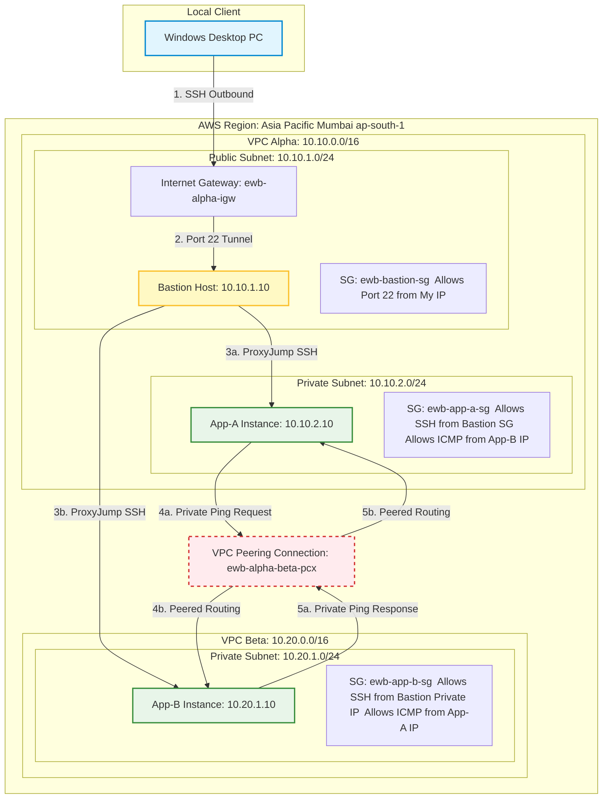

# ewb-secure-vpc-peering
# Build Secure AWS VPC Peering

This project demonstrates the design, deployment, and validation of a secure, multi-VPC cloud network in Amazon Web Services (AWS) using the Asia Pacific (Mumbai) region. This infrastructure features a public-facing bastion host acting as a secure gateway, providing controlled SSH access to private application instances in isolated VPCs. 

To bridge these isolated networks securely, VPC Peering was implemented, and route tables were custom-configured for private, same-region routing. The entire environment was rigorously validated using a multi-stage ICMP diagnostic audit to demonstrate network security, traffic isolation, and recovery.

---

## 🛠️ Project Objectives
- **Secure Network Architecture:** Design and deploy two distinct Virtual Private Clouds (VPC Alpha and VPC Beta) with isolated public and private subnets.
- **Granular Perimeter Access:** Implement a public-facing Bastion Host as a secure, single-choke-point gateway to shield private environments from direct internet exposure.
- **Least-Privilege Security Boundaries:** Configure tailored Security Groups to restrict traffic strictly to defined SSH tunnels (via ProxyJump) and explicit ICMP echo requests.
- **Secure Transit Bridging:** Establish an active VPC Peering Connection to allow private, reliable routing between non-overlapping CIDR blocks.
- **Diagnostic Network Auditing:** Execute and document baseline, peer connection, security enforcement, and connection recovery tests using Linux ping.

---

## 📐 Architecture Diagram
This diagram shows the complete traffic and routing paths designed, built, and tested in this project. You can view the local client's connection path hopping through the public gateway to administer the private application layers, alongside the private peering bridge:

---

## 📋 Infrastructure & Resource Inventory
The detailed audit of all provisioned networking, security, and computing resources (including actual AWS Resource IDs, subnets, custom route tables, and security groups) is recorded in:
📂 **[docs/resource-inventory.md](docs/resource-inventory.md)**

---

## 🧪 Network Diagnostics & Test Results
This lab uses a rigorous test-driven validation model to prove absolute security. Below is a summary of the test phases executed. The complete console commands, parameters, and live terminal outputs can be reviewed in:
📂 **[docs/test-results.md](docs/test-results.md)**

### Test Summary
1. **Pre-Peering Baseline (App-A to App-B):** `FAIL` (Confirmed perfect isolation of 100% packet loss between separate VPCs before peering).
2. **Forward Peering (App-A to App-B):** `PASS` (Confirmed successful private routing at 0% packet loss over the peering connection).
3. **Reverse Peering (App-B to App-A):** `PASS` (Confirmed bidirectional pathing at 0% packet loss).
4. **Controlled ICMP Security Failure:** `FAIL` (Proved that removing explicit ICMP security group rules blocks traffic even with active peering).
5. **ICMP Recovery Test:** `PASS` (Proved immediate, secure path restoration upon restoring the security group rule).

---

## 💻 Key Takeaways
- **SSH ProxyJump & Key Hardening:** Gained deep experience with local OpenSSH configurations on Windows. Moved key files to `%USERPROFILE%\.ssh\config` and modified security permissions to satisfy single-owner standards (removing SYSTEM and Administrator inheritance) to establish multi-hop SSH jumps into hidden instances.
- **Security-First Network Design:** Witnessed firsthand that VPC Peering acts solely as a physical bridge; security groups act as the ultimate logical barrier. This is critical for defending multi-tier enterprise systems.
- **Automated Alerts & Cost Monitoring:** Handled AWS Billing consoles, successfully identifying cost anomaly alerts caused by sudden baseline deviation and tracking public IPv4 charges.
